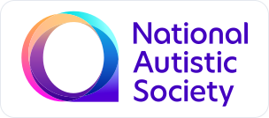
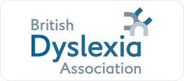
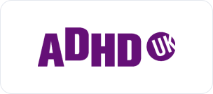

<h1 align="center">Support neurodiversity</h1>

  Diffyn is built voluntarily and remains free to use and fork. 
  If you would like to give, support an independent charity below.

  <strong>No affiliation. No obligation.</strong> 
  Donations go directly to your chosen charity.

---

<h2 align="center">National Autistic Society</h2>

  

Advice, services and advocacy for autistic people and their families.

  

  
  

---

<h2 align="center">British Dyslexia Association</h2>

  

Information, support and advocacy for dyslexic people in education, work and everyday life.

  

  
  

---

<h2 align="center">ADHD UK</h2>

  

Information, support, research and advocacy for people affected by ADHD.

  

  
  

---

<a href="../README.md">Back to Diffyn</a>

