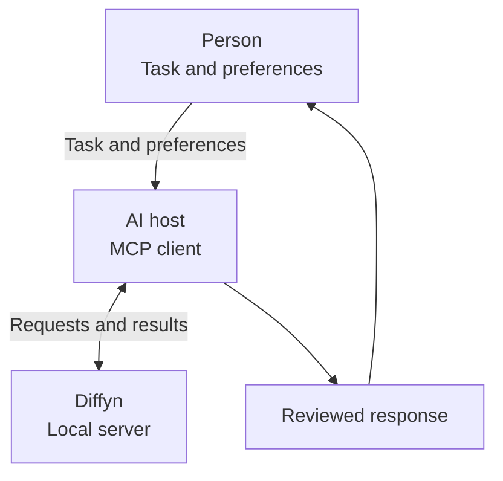
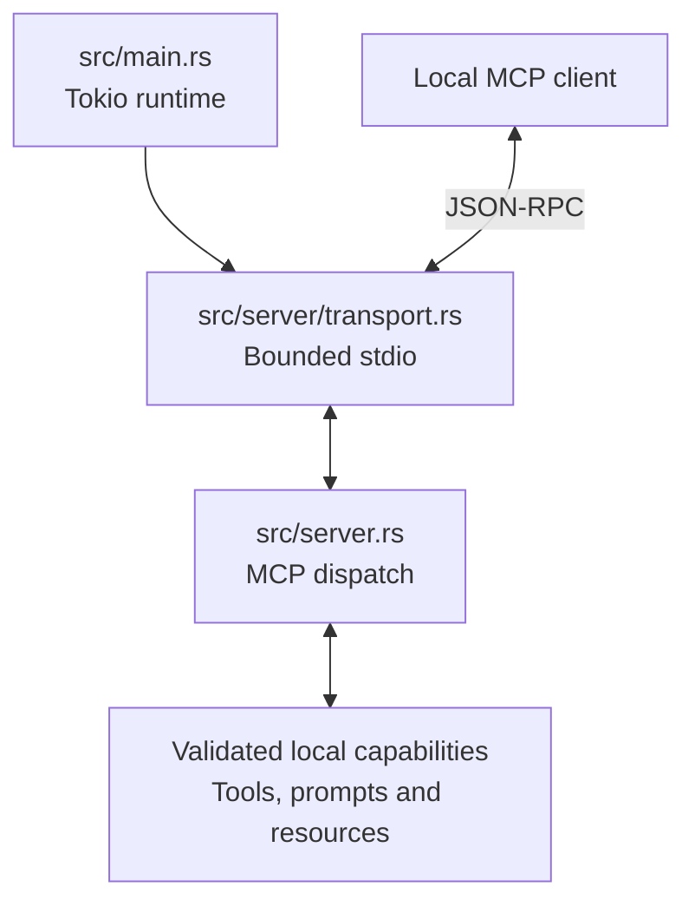
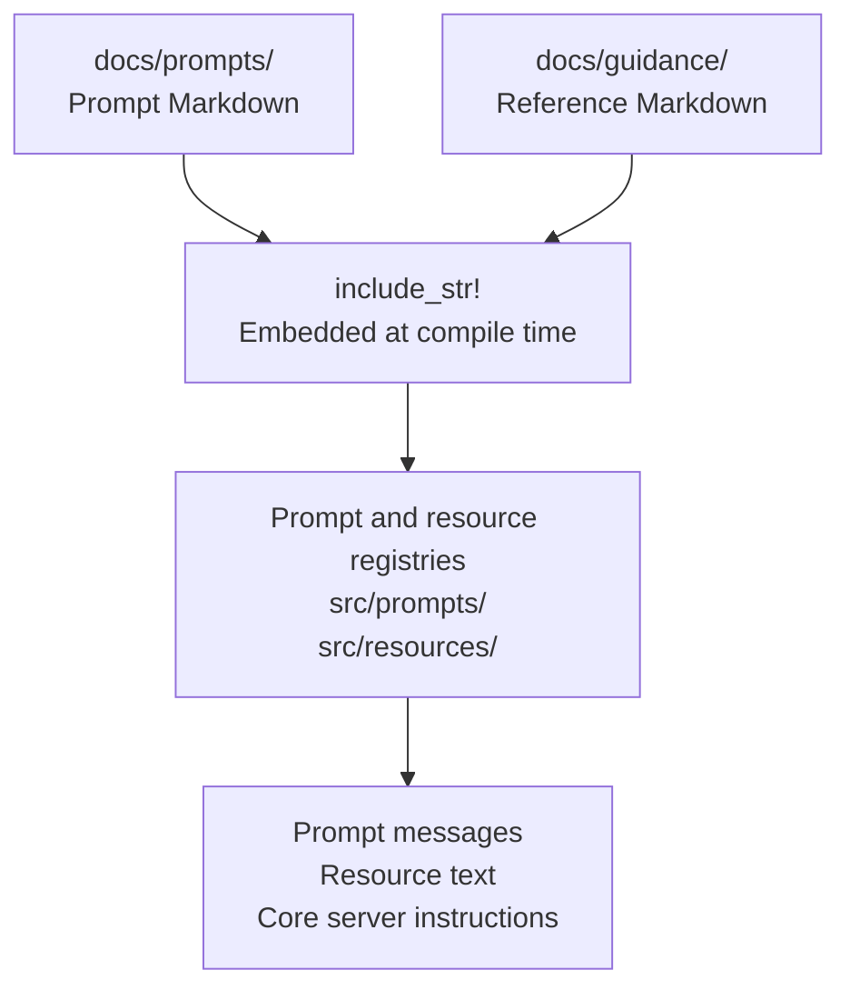

# How Diffyn works

**Diffyn runs locally** as a Rust process connected to an AI host through MCP over standard input and output.

The host chooses when to use its **three tools**, **two prompts** and **four resources**, then reviews what to present to the person.

## The communication flow

**Text alternative:** The person gives the host a task and any preferences; the host can request local tools or guidance from Diffyn, review the result and present a response.

- **Choice:** A person can request an accommodation without naming a neurotype.
- **Control:** The host decides which capabilities to invoke and how to apply their results.
- **Review:** Tool output retains the source and makes uncertainty available to the host.
- **Rendering:** Fonts, colours, spacing and assistive-technology support belong to the host interface.

Diffyn does not automatically intercept every response or run an LLM inside the server.

## Runtime request flow

**Text alternative:** The runtime starts the stdio transport, which passes MCP requests to the server dispatcher; the dispatcher invokes local tools, builds prompt messages or reads embedded resources, then returns the result through the same transport.

**Tool preferences:** Each tool validates explicitly supplied settings and uses neutral defaults for omitted preferences.

## Embedded prompts and guidance

**Text alternative:** Prompt and guidance Markdown is embedded during compilation, then the prompt and resource modules expose that fixed text through MCP; the core guidance also supplies the server instructions.

**Build-time content:** Rust's `include_str!` embeds the Markdown in `docs/prompts/` and `docs/guidance/` into the executable, so changing those files requires rebuilding the server.

## What each module does

- **[Entry point](../src/main.rs):** Creates the Tokio runtime and limits how long runtime shutdown can wait.
- **[Transport](../src/server/transport.rs):** Applies a 1 MiB incoming JSON-line limit and handles EOF or stop signals.
- **[Server](../src/server.rs):** Publishes capabilities, routes requests and prevents tool errors from echoing submitted content.
- **[Tools](../src/tools/):** Validate text and explicit preferences before formatting layout, extracting steps or finding possible idioms.
- **[Prompts](../src/prompts/mod.rs):** Return a static template and separate user-role messages containing supplied context and preferences.
- **[Resources](../src/resources/mod.rs):** Resolve four exact resource URIs without interpreting them as file paths or network addresses.

The **same core-instruction text** appears in server metadata and at `diffyn://guidance/core-instructions`.

## A tool request, step by step

1. **Receive:** The local client sends a JSON-RPC message within the transport limit.
2. **Deserialize:** The SDK maps tool arguments to Rust types that reject unknown fields.
3. **Validate:** Diffyn rejects blank or oversized text and out-of-range preferences.
4. **Process:** A deterministic operation produces a result without network calls or persistent storage.
5. **Return:** The server sends structured JSON and a matching JSON text block for client compatibility.
6. **Review:** The host considers the result, original content, warnings and limitations before presenting it.

The [communication contract](communication-contract.md) describes each tool's actual settings and limits.

## Privacy and lifecycle

**The application is stateless:** Diffyn keeps no profile database, conversation store or analytics history.

- **Local processing:** Submitted text is handled in process memory and returned as part of the requested result.
- **No content logging:** The binary installs no tracing subscriber and uses fixed operational error messages.
- **Fixed resources:** References in bundled guidance are citations that the server does not fetch.
- **Bounded shutdown:** Cancellation has a three-second cleanup deadline, followed by a 250-millisecond runtime shutdown limit.
- **Client boundary:** The host may retain messages or call cloud services under its own policies.

These properties do not guarantee memory zeroization or control operating-system crash dumps.

## What verification covers

**Unit tests** cover text preservation, preference handling, input validation and prompt/resource boundaries.

**Process tests** exercise actual stdio messages, two tested lifecycle paths, malformed-input recovery, privacy checks and shutdown on Linux and macOS.

Host rendering, Windows-specific lifecycle behaviour and participatory evaluation require separate checks before making broader claims.

Continue with the [engineering guide](engineering.md), [request examples](examples.md) or [research basis](research.md).
